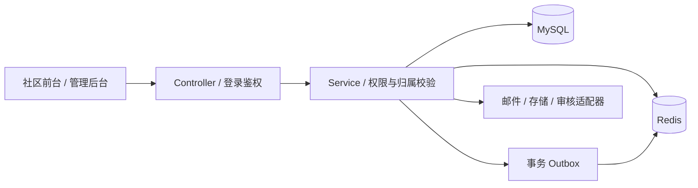

# HKUer Backend

校园社区后端，基于 **Java 21 + Spring Boot 3.4 + MyBatis-Plus + MySQL + Redis**。保留原账号、帖子、点赞、收藏、评论和管理服务，扩展问答、课程、小组、二手、租房、通知与私信。

**配套前端：[hkuer-frontend](https://github.com/jerry021211/hkuer-frontend)**。这是独立 Maven 项目，克隆后直接打开根目录 pom.xml，不依赖前端仓库的位置。

## 技术结构



- 沿用 Controller → Service → Mapper 和 Result 返回规范。
- 新领域接口为 /mesh/*，管理扩展为 /console/mesh/*。
- Flyway V001–V012 维护数据库结构；登录、点赞、收藏等继续复用原服务。
- 开发与测试使用独立 MySQL 库、Redis 逻辑库和 key 前缀。

## 准备环境

需要 JDK 21、Maven 3.6.3+、MySQL 8.0+ 和 Redis 5+。Windows 初始化/启动脚本使用 PowerShell；演示数据与冒烟脚本另需 Node.js 20.19+ 或 22.12+。

```powershell
git clone https://github.com/jerry021211/hkuer-backend.git
cd hkuer-backend
.\scripts\init-local.ps1
```

初始化脚本只在本仓库 .local/mesh/ 生成随机数据库密码、JWT 密钥、管理员密码和 bootstrap.sql；不连接数据库，不覆盖已有配置。

使用 MySQL 管理员导入 .local/mesh/bootstrap.sql。它创建 hkuer_mesh_dev、hkuer_mesh_test 和专用用户。若 hkuer_mesh 用户已存在，可在首次初始化时传入 -DatabaseUser 指定新用户名；不要重置已有账号或清空旧库。

启动 Redis，并在 .local/mesh/application-local.properties 填写实际连接参数与密码。默认如下：

| 环境 | HTTP 端口 | MySQL | Redis |
|---|---|---|---|
| 开发 | 9091 | 3306 / hkuer_mesh_dev | 6379 / DB 2 |
| 测试 | 9092（测试启动脚本） | 3306 / hkuer_mesh_test | 6379 / DB 3 |

无需执行历史 SQL 补丁，首次启动时 Flyway 自动建表。Redis 使用现有实例上的专用逻辑库；脚本不会启动 MySQL 或 Redis 服务。

非 Windows 系统可将 [配置模板](config/application-local.properties.example) 复制到 .local/mesh/application-local.properties，自行创建两个空库及专用数据库用户，并将模板中的数据库密码、JWT 密钥（至少 64 个随机字符）、管理员密码全部替换。

## IDEA 一键运行

1. 在 IDEA 打开本仓库根目录的 pom.xml，选择 JDK 21。
2. 将 HkuerApplication 的运行工作目录设为本仓库根目录。
3. 完成上述本地配置与数据库初始化后，直接点击运行，无需每次添加参数。

默认加载本仓库 .local/mesh/application-local.properties。可用环境变量 HKUER_LOCAL_CONFIG 指定其他配置路径；原始工作区的配置不受此仓库影响。

也可以从本仓库根目录运行：

```sh
mvn spring-boot:run
```

或在 Windows 使用 `.\scripts\start-mesh-backend.ps1`，自动构建并在后台启动。日志位于 .local/mesh/。Java 从 JAVA_HOME/PATH 查找，Maven 从 PATH 查找。

启动后访问 <http://127.0.0.1:9091/mesh/public/session> 验证游客会话接口。配套前端默认通过 Vite 代理访问此端口。

开发管理员为 mesh_admin（或 admin@mesh.local），随机密码在本机 .local/mesh/secrets.json。可运行 `node scripts/seed-mesh-demo.mjs` 写入合成演示数据；它只访问开发后端，不导入参考网站用户或内容。

## 构建与验证

```powershell
# 无需数据库的单元与配置测试
mvn "-Dtest=JwtAuthenticationFilterTest,LikeServiceImplTest,PayServiceImplTest,ViewCountBatchWriterTest,CloudServicesConfigurationTest,MailModeConfigurationTest,CloudServicesTest" test

# 构建
mvn -DskipTests package

# 完整测试需要先准备测试库和 Redis DB 3
mvn test
```

业务冒烟从仓库根目录运行，会在专用测试库创建合成记录：

```powershell
.\scripts\start-mesh-backend.ps1 -Test -SkipBuild
node scripts/smoke-mesh.mjs
node scripts/smoke-mesh-domains.mjs
```

脚本使用 9092、hkuer_mesh_test 和 Redis DB 3。不要指向生产数据库。真实云服务测试默认跳过，只有显式开启 CloudServicesLiveTest 并配置有效凭据时才访问外部服务。

## 目录

```text
pom.xml                         Maven 项目入口
src/main/java/                  Controller、Service、Mapper、Entity
src/main/resources/db/mesh/     Flyway 迁移
src/test/                       单元、配置与集成测试
config/                         无凭据配置模板
scripts/                        初始化、启动、演示数据与冒烟测试
docs/                           架构、接口与一致性说明
.local/                         本机配置和运行数据，Git 忽略
```

## 运行模式与边界

初始化模板显式启用本地邮件与云适配器；源码默认云模式仍为 aliyun。真实云凭据只写入私有配置，不提交源码。

| 能力 | 本地模式 |
|---|---|
| 邮件 | 验证码写入 .local/mesh/mail，不发送真实邮件 |
| 文件 | 写入 .local/mesh/uploads，云模式使用 OSS |
| 审核 | 本地适配器直接通过，仅用于 localhost 开发 |
| 翻译 | 返回未配置，不生成假译文 |
| RabbitMQ | 默认关闭监听，使用本地 Outbox 处理缓存失效 |
| 支付 | 保留原实现，开发配置禁用支付网关 |

项目用于开发与演示，生产云服务、支付及基础设施仍需单独配置与验收。数据库数据、密码、密钥、邮件、上传文件、日志、target 和 IDE 文件不进入仓库。

## 开发文档

- [架构与开发约定](docs/architecture.md)
- [接口分组与复用](docs/api-overview.md)
- [互动数据一致性](docs/interaction-consistency.md)

拆分只调整仓库目录、相对配置路径、启动脚本和文档，保留原业务逻辑、数据库迁移和测试。未携带旧 Gitee 历史，尚未额外声明开源许可证。
